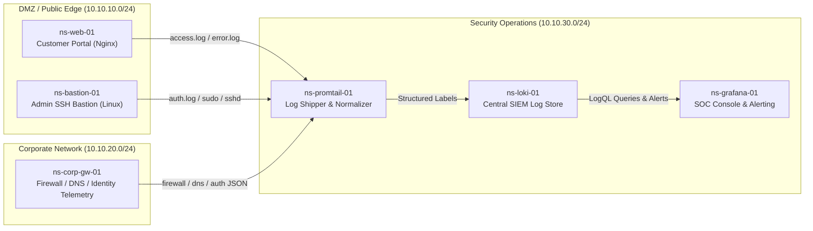

# Northstar FinTech — Enterprise SOC Operations Portfolio

A practical, enterprise-modeled Security Operations Center (SOC) portfolio built around a simulated financial technology organization (**Northstar FinTech**). Every architecture document, detection rule, playbook, incident report, and risk assessment reflects real-world Tier 1 / Tier 2 SOC workflows.

---

## Enterprise Architecture Overview

---

## Portfolio Projects & Progress

| Project | Focus Area | Key Artifacts | Status |
| :--- | :--- | :--- | :--- |
| **Project 1** | Enterprise SOC Lab, Log Pipeline & Sigma Detections | [Asset Inventory](architecture/asset-inventory.md), [Log Onboarding Plan](architecture/log-onboarding-plan.md), [Docker SOC Lab](lab-environment/docker-compose.yml), Sigma Rules | In Progress (Phase 1–2) |
| **Project 2** | Live SOC Triage, Incident Investigation & Playbooks | SOC SOP Playbooks, True/False Positive Case Reports, PCAP Analysis, Detection Tuning Tickets | Planned |
| **Project 3** | Vulnerability Management & SOC Operations Metrics | Risk-Prioritized CVE Report, SOC KPI Dashboard (MTTD/MTTR/FP Rate), SOAR Enrichment Runbook | Planned |

---

## Repository Layout

- `architecture/` — CMDB asset inventory, network segmentation, and SIEM log onboarding standards.
- `lab-environment/` — Reproducible Docker Compose enterprise network + Grafana/Loki/Promtail SIEM stack.
- `detections/` — Vendor-neutral Sigma detection rules (YAML) mapped to MITRE ATT&CK and validation reports.
- `playbooks/` — Step-by-step Tier 1/2 Standard Operating Procedures (SOPs) for alert triage and containment.
- `incidents/` — Realistic SOC investigation case files documenting timelines, queries, IOCs, and tuning actions.
- `vulnerability-mgmt/` — Risk-based vulnerability reports and executive SOC posture metrics.
